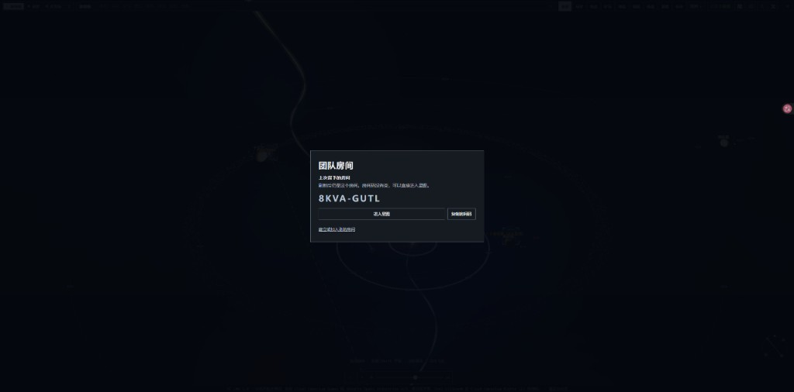

# SC LMW – Star Citizen LiveMap Wiki

**Version 1.1.0** · AGPL-3.0 · Starfix 1.0.6

**English** · [Deutsch](README.de.md) · [简体中文](#简体中文) · [繁體中文](#繁體中文)

**Website / 网站 / 網站：** https://gugugubear.pythonanywhere.com/

**Your whole 'verse on one screen.** A free, open-source 3D map of Star Citizen: every system, planet, moon, station and jump point, a search that knows where to find every ore, item, ship, commodity, blueprint and mission, live trade prices, holographic 3D ships, and your own org's pilots flying around on it in real time.

Drop it into your org website with one line of HTML, or hand the included prompt to an AI and let it do the wiring for you.

> **Unofficial fan project.** Not endorsed by, sponsored by, or affiliated with Cloud Imperium Games or Roberts Space Industries. Star Citizen® is a trademark of Cloud Imperium Rights LLC. The same notice is shown inside the app.

## What's new in 1.1.0

The interface is Simplified Chinese, Traditional Chinese, English, and German. The first visit follows the browser. The language button switches live, and that choice stays on this browser. German shows German game labels. Chinese shows Chinese place names. English keeps the English names.

The same note is in [docs/WHATS_NEW.md](docs/WHATS_NEW.md). Starfix, the optional log reader, stays at 1.0.5. Read [companion/README.md](companion/README.md) before you run it.

### English

- **Install the map.** On a phone or tablet, Chrome and Edge can add it to the home screen. On iPhone and iPad, open Share and choose Add to Home Screen. It then opens on its own. After one visit, the page itself still opens when the network is gone. The room list and live prices still need the network.
- **A small screen keeps the map visible.** Category buttons scroll sideways. On a phone the room panel is a bar until you tap Expand. Buttons are large enough to tap, and the page stays clear of a notch or the home indicator.
- **The home page uses your theme.** Classic, Compact, Practical, Chassis, and Sci-fi each color the cards. A short note says when Starfix helps, and links to the guide, the published Starfix 1.0.5, and the source.
- **A room is public or private.** The captain switches it. Public rooms are listed on the home page, busiest first, and anyone can read that list. Joining a public room does not wait for approval. Each switch waits five minutes. A room stays private until the captain opens it.
- **This browser remembers 90 rooms.** Each line says whether the room still exists and how many people are in it. You are only in one room at a time. Entering another room leaves the previous one.
- **A teammate stays on one line.** A long place, ship, or server scrolls back and forth. Offline members keep their last place. A click moves the view there, including a Lagrange point. With Starfix 1.0.5 the card can also show the game server and where that pilot is flying.
- **A shared route leaves the camera where you put it.**
- **Planets and moons are painted as different worlds.** Place marks stay readable in Pyro and Nyx.

### Deutsch

- **Die Karte lässt sich installieren.** Auf einem Telefon oder Tablet können Chrome und Edge sie zum Home-Bildschirm hinzufügen. Auf iPhone und iPad öffnest du Teilen und wählst „Zum Home-Bildschirm“. Danach öffnet sie sich allein. Nach einem Besuch öffnet sich die Seite auch ohne Netz. Raumliste und Live-Preise brauchen das Netz weiter.
- **Auf einem kleinen Bildschirm bleibt die Karte sichtbar.** Die Kategorien lassen sich seitlich schieben. Auf einem Telefon ist der Raum nur eine Leiste, bis du auf Ausklappen tippst. Die Knöpfe sind groß genug für den Daumen, und die Seite hält Abstand zu Kerbe und Home-Anzeige.
- **Die Startseite trägt dein Thema.** Klassisch, Kompakt, Praktisch, Gehäuse und Science-Fiction färben die Karten. Ein kurzer Text sagt, wann Starfix hilft, und verlinkt die Erklärung, das veröffentlichte Starfix 1.0.5 und den Quelltext.
- **Ein Raum ist öffentlich oder privat.** Der Captain schaltet das um. Öffentliche Räume stehen auf der Startseite, die vollsten zuerst, und jeder darf die Liste ansehen. Wer einem öffentlichen Raum beitritt, wartet nicht auf Zustimmung. Jeder Wechsel wartet fünf Minuten. Ein Raum bleibt privat, bis der Captain ihn öffnet.
- **Dieser Browser merkt sich 90 Räume.** Jede Zeile sagt, ob der Raum noch da ist und wie viele Leute darin sind. Du bist immer nur in einem Raum. Wer einen anderen betritt, verlässt den vorigen.
- **Ein Teammitglied bleibt in einer Zeile.** Ein langer Ort, ein Schiff oder ein Server läuft hin und her. Offline bleibt der letzte Ort stehen. Ein Klick setzt die Ansicht dorthin, auch auf einen Lagrange-Punkt. Mit Starfix 1.0.5 kann die Karte auch den Spielserver und das Flugziel zeigen.
- **Eine geteilte Route lässt die Kamera, wo du sie hingestellt hast.**
- **Planeten und Monde sind als verschiedene Welten gemalt.** Die Ortsmarken bleiben in Pyro und Nyx lesbar.

### 简体中文

- **可以把星图装到主屏幕。** 手机或平板上，Chrome 和 Edge 可以直接安装。iPhone 和 iPad 先点分享，再选「添加到主屏幕」。装好以后它单独打开。访问过一次之后，没网也能打开页面本身。房间列表和实时价格仍然需要网络。
- **小屏幕上星图仍然留在画面里。** 分类按钮横向滑动。手机上房间先收成一条，点「展开」再打开。按钮够大，方便用手指点。刘海和底部横条不会挡住操作。
- **首页跟着你选的主题。** 经典、紧凑、实用、机壳、科幻各自给卡片上色。一段短说明告诉你什么时候需要 Starfix，并链到说明、已发布的 Starfix 1.0.5 和源码。
- **房间可以公开或私人。** 队长来切换。公开房间出现在首页，人多的排在前面，谁都可以看这份列表。进入公开房间不用等队长批准。每次切换之后要等五分钟。房间保持私人，直到队长把它打开。
- **这个浏览器记住最近 90 个房间。** 每一行都会写这个房间还在不在，以及里面有几个人。同一个人每次只在一个房间里。进入另一个房间时，会先离开上一个。
- **队员保持一行。** 地点、舰船或服务器太长时，会来回滚动。离线队员保留最后的地点。点一下就把画面移过去，拉格朗日点也一样。开着 Starfix 1.0.5 时，名片上还可以看到游戏服务器，以及这个人正在飞往哪里。
- **点一条已分享的路线，不会把视角抢走。**
- **行星和卫星各自有自己的表面。** 派罗和尼克斯里的地点标记仍然看得清。

### 繁體中文

- **可以把星圖裝到主畫面。** 手機或平板上，Chrome 和 Edge 可以直接安裝。iPhone 和 iPad 先點分享，再選「加入主畫面」。裝好以後它單獨打開。造訪過一次之後，沒有網路也能打開頁面本身。房間列表和即時價格仍然需要網路。
- **小螢幕上星圖仍然留在畫面裡。** 分類按鈕橫向滑動。手機上房間先收成一條，點「展開」再打開。按鈕夠大，方便用手指點。瀏海和底部橫條不會擋住操作。
- **首頁跟著你選的主題。** 經典、緊湊、實用、機殼、科幻各自給卡片上色。一段短說明告訴你什麼時候需要 Starfix，並連到說明、已發布的 Starfix 1.0.5 和源碼。
- **房間可以公開或私人。** 隊長來切換。公開房間出現在首頁，人多的排在前面，誰都可以看這份列表。進入公開房間不用等隊長批准。每次切換之後要等五分鐘。房間保持私人，直到隊長把它打開。
- **這個瀏覽器記住最近 90 個房間。** 每一行都會寫這個房間還在不在，以及裡面有幾個人。同一個人每次只在一個房間裡。進入另一個房間時，會先離開上一個。
- **隊員保持一行。** 地點、艦船或伺服器太長時，會來回捲動。離線隊員保留最後的地點。點一下就把畫面移過去，拉格朗日點也一樣。開著 Starfix 1.0.5 時，名片上還可以看到遊戲伺服器，以及這個人正在飛往哪裡。
- **點一條已分享的路線，不會把視角搶走。**
- **行星和衛星各自有自己的表面。** 派羅和尼克斯裡的地點標記仍然看得清。

| The room is still there after a refresh | The team room on the Stanton map |
|---|---|
|  |  |

| Connect Starfix on this computer | Down to a planet |
|---|---|
|  |  |

| A place open in Stanton | Pyro |
|---|---|
|  |  |

---

## What you can do with it

- **Run your org like a fleet command.** See who is online and where they are: Levski, Orison, a Pyro rest stop or halfway through a quantum jump. Five pilots at the same station collapse into one clean marker ("Levski · 5 pilots, 2 online"); tap it for the list.
- **Find anything in seconds.** Type "Quantanium", "Arrow", "Laranite", "P4-AR" or "Lorville" and the map flies you there. The search covers locations, ores, items, ships, commodities, blueprints and missions.
- **Plan trade runs.** Open any terminal and see live buy and sell prices from UEX, straight from the source, no API key needed.
- **Hunt blueprints.** Every blueprint in the game data with its full crafting recipe (parts, resources, minimum quality), and which missions reward it.
- **Scout missions.** See which mission types are offered where and by whom, and which blueprints they can reward.
- **Go mining.** Find which planets, moons and belts carry the ore you are after.
- **Run the big loops.** Contested Zones (Checkmate, Orbituary, Ruin Station), the supervisor stations and the Executive Hangar show the full procedure right at the location: a live Executive Hangar timer with the 5 status lights, a Ruin vault door timer you sync once per server, tap-to-start respawn timers, which keycards and boards you get or need, and the route maps. Align & Mine, Storm Breaker (Apex Valakkar), Siege of Orison and Jumptown are explained at their locations too, all linked to each other.
- **Find loot.** Item view shows which container and location types an item can drop from, ranked from best to rarer chance (optional, built from the Friendly Fire Department game-data export with `--with-loot`).
- **Install it on a phone or tablet.** Add the site to the home screen. On a narrow screen the categories scroll sideways, the room panel stays a bar until you expand it, and the buttons are large enough to tap.
- **Keep one team room.** The captain can make it public or leave it private. Public rooms are listed on the home page, busiest first, and do not need approval. This browser remembers the last 90 rooms and shows which ones are still open.
- **Show off the fleet.** Rotating holographic 3D models of the ships, loaded live from FleetYards, with specs, prices and where to buy or rent.
- **Put it on stream.** It runs in any browser source, so it works as an overlay or info screen for streams and org meetings.
- **Make it yours.** Plain HTML, CSS and JavaScript. No framework and no build step for the frontend, easy to restyle and extend.

## Install in 3 steps

You need Python 3 (to build the game data once) and any static web server.

```sh
# 1. Get the code
git clone https://github.com/GuguguBear/sc-lmw.git
cd sc-lmw

# 2. Build the game data (downloads the community game-data export and reference lists,
#    writes ./data/*.json; this takes a few minutes and needs internet access)
python3 scripts/build-all.py

# 3. Serve it and open http://localhost:8000/
python3 -m http.server 8000
```

That's it. You will see the map with five fictional demo pilots. Re-run step 2 after a game patch to refresh the data.

Optional: `python3 scripts/build-all.py --with-de` adds the German in-game texts (community translation, CC BY-NC-SA, see `scripts/README_DE_INI.md`).

## Put it on your website

**Option A: iframe (simplest, one line).** Upload the folder to your web host, then:

```html
<iframe src="https://your-site.example/sc-lmw/index.html"
        style="width:100%;height:640px;border:0" allow="fullscreen"></iframe>
```

**Option B: directly in your page.** A container and one script tag:

```html
<div id="sc-lmw" style="height:640px"></div>
<script src="https://your-site.example/sc-lmw/js/sc-lmw.js"
        data-base="https://your-site.example/sc-lmw/"
        data-players-url="https://your-site.example/api/players"></script>
```

The map stays inside its box. It never styles your `body`, fonts or layout, uses one global name (`window.SCLMW`), scales with its container and works from any domain or sub-folder. Both ways are tested against a deliberately "hostile" guest page: see [`examples/iframe.html`](examples/iframe.html) and [`examples/embed.html`](examples/embed.html).

## Interface language

The interface — buttons, panels, search, legend, error messages, time phrases, number format — is available in German, English, Simplified Chinese and Traditional Chinese. It follows the visitor's browser language (`zh-TW` / `zh-HK` / `zh-MO` → Traditional Chinese, other `zh*` → Simplified Chinese, `de*` → German, otherwise English). The language button opens the list and switches live, without a reload. The choice is remembered in that browser. You can also set it explicitly:

- `LANG` in `config.js`: `'auto'` (default), `'de'`, `'en'`, `'zh-Hans'`, or `'zh-Hant'`. `zh` / `zh-CN` / `zh-SG` count as Simplified, `zh-TW` / `zh-HK` / `zh-MO` as Traditional.
- `data-lang="zh-Hans"` on the `sc-lmw.js` script tag (direct-embed method).
- `mount(el, { lang: 'zh-Hans' })` if you call `SCLMW.mount()` yourself.

Choosing German also shows German mission and amenity names. Choosing Chinese shows Chinese place names. English keeps the English names. Details for visitors are in [docs/WHATS_NEW.md](docs/WHATS_NEW.md).

## Appearance

Six interface themes, switched from the ▣ button next to the language control and remembered in the browser: Classic (the original look), Compact, Practical, Chassis, Sci-fi, and Haze.

- `THEME` in `config.js`: `'compact'` (default), `'classic'`, `'practical'`, `'chassis'`, `'scifi'`, or `'haze'`.
- `data-theme="chassis"` on the script tag, or `mount(el, { theme: 'chassis' })`.
- A visitor's own choice wins over this default.

## Show your own pilots

Point `PLAYERS_URL` in `config.js` (or `data-players-url` on the script tag) at a small endpoint of yours that returns JSON like this:

```json
{
  "players": [
    { "id": "pilot-1", "name": "Pilot Alpha", "online": true,
      "last_seen": "2026-09-28T09:58:00Z",
      "code": "Nyx_Levski", "location": "Levski", "system": "Nyx",
      "ship": "Drake Cutlass Black" }
  ]
}
```

`code` is the location code Star Citizen writes into its `Game.log`. The map resolves it to the right station, city, outpost or rest stop by itself. Where that data comes from is up to you: a Discord bot, a companion app your members run, or a form on your site. The full contract, including travel destinations, the optional `when` field, refresh interval (`PLAYERS_POLL_MS`) and custom headers, is in [`docs/PLAYERS_API.md`](docs/PLAYERS_API.md).

## Let an AI build it into your site

[`docs/AI_INTEGRATION.md`](docs/AI_INTEGRATION.md) contains a complete, copy-paste prompt (English and German) for Claude, ChatGPT or any coding assistant. It explains your setup to the AI: copying the files, building the data, choosing iframe or direct embed, creating a players endpoint (with ready examples for Node/Express, Python/Flask and PHP), CORS, keeping the fan-project notice visible, and your AGPL obligations. Paste it, add one line about your own site, and the AI can do the rest without asking back.

Short version to get started:

```text
I want to add SC LMW (https://github.com/GuguguBear/sc-lmw), an open-source
Star Citizen 3D map, to my website. Read its README.md, docs/AI_INTEGRATION.md and
docs/PLAYERS_API.md, then: build the data with scripts/build-all.py, embed the map
(iframe or the sc-lmw.js script tag), and create a players endpoint in my backend that
returns the JSON format from PLAYERS_API.md. Keep the "unofficial fan project" notice
visible. My site is: <describe your stack and where the map should appear>.
```

## Where the data comes from

| What | Source | How |
|---|---|---|
| Locations, ores, items, blueprints, missions | community `scunpacked-data` export of the game files | built locally by `scripts/`, **not shipped** in this repo |
| Trade prices | [UEX Corp](https://uexcorp.space) API | fetched live in the browser |
| Ship specs and 3D models | [FleetYards](https://fleetyards.net) | fetched live in the browser, credited in the app |
| 3D engine | [three.js](https://threejs.org) r128 (MIT) | included under `vendor/three/` |
| Your pilots | your own `PLAYERS_URL` | optional |

Game data and images are not redistributed here. Every user builds them from the original sources. RSI star-map images are intentionally not downloaded. Full attribution: [`CREDITS.md`](CREDITS.md).

**Guides and optional extras**

- Gameplay procedures and route maps: [starcitizen.tools](https://starcitizen.tools) (maps and photos CC BY-SA 4.0, see `img/guides/` and CREDITS.md).
- Executive Hangar cycle: [exec.xyxyll.com](https://exec.xyxyll.com) (MIT). `scripts/exec-build.py` refreshes it into `data/exec.json` (run by `build-all.py`; without it the map uses built-in values).
- Respawn times: [exectimer.com](https://exectimer.com).
- Loot locations: [Friendly Fire Department](https://thefriendlyfiredepartment.org) game-data export, only with `python3 scripts/build-all.py --with-loot`. Not redistributed in this repository.

## Project layout

```
index.html              standalone page
manifest.webmanifest    installable app: name, icons, standalone display
sw.js                   offline shell for this site; room APIs stay on the network
icons/                  home-screen icons
config.js               the one file most people edit (PLAYERS_URL, ...)
players.example.json    five fictional demo pilots
js/starmap.js           map engine: 3D scene, search, categories, prices, blueprints, missions
js/holo.js              FleetYards 3D ship models
js/i18n.js              interface language (de / en / zh-Hans / zh-Hant)
js/sc-lmw.js            one-script-tag loader for embedding
css/starmap.css         styles under .sc-lmw; themes classic, compact, practical, chassis, scifi
vendor/three/           three.js r128 + loaders (MIT)
scripts/                data build pipeline (Python)
examples/               iframe and direct-embed examples
docs/                   players API, AI integration prompt, screenshots
companion/              optional local Starfix. Source you can read. See companion/README.md
server/                 optional room service. The page does not read the game folder
```

## Show us what you build

Fork it, restyle it, add features, run it for your org. If you build something with it, we would love to see it: open an issue on this repository and tell us. No obligation, just curiosity.

## License

**AGPL-3.0** (see [`LICENSE`](LICENSE)). You may use, change and share it freely. If you run a **modified** version on a server that other people use, you must make your modified source code available to them as well. Third-party code and data keep their own licenses, see [`CREDITS.md`](CREDITS.md).
