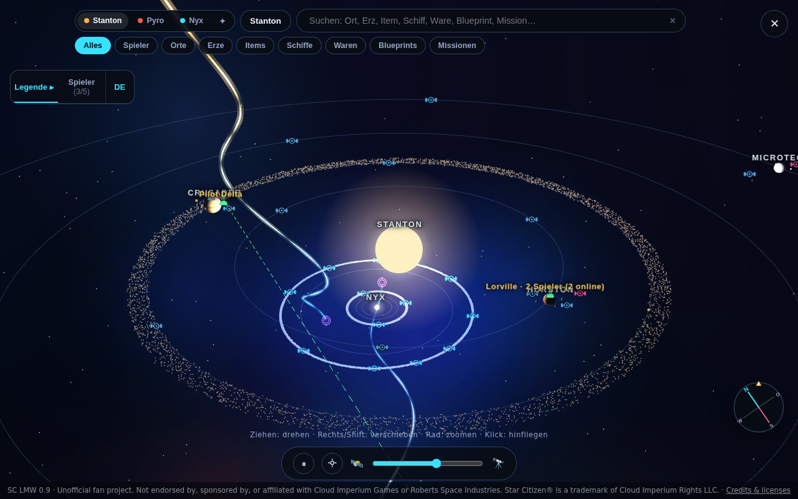
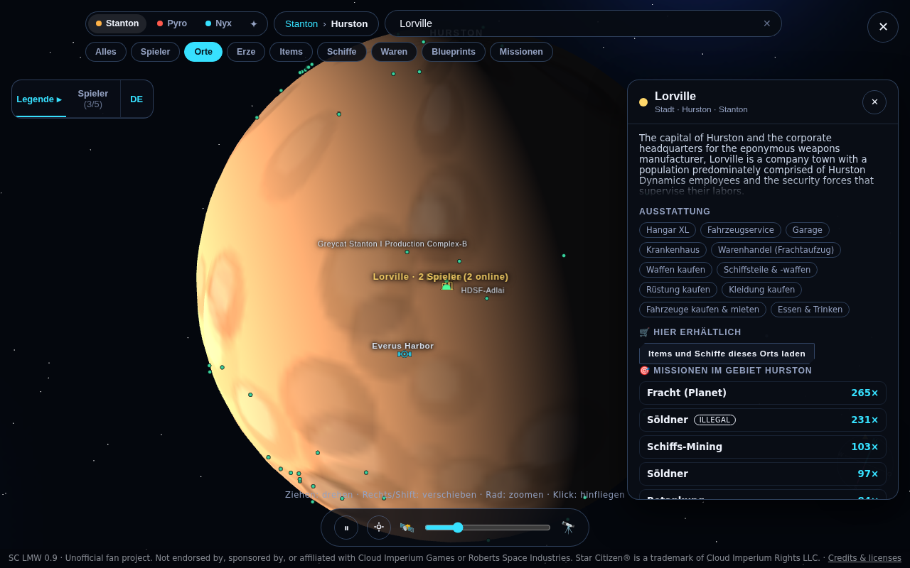
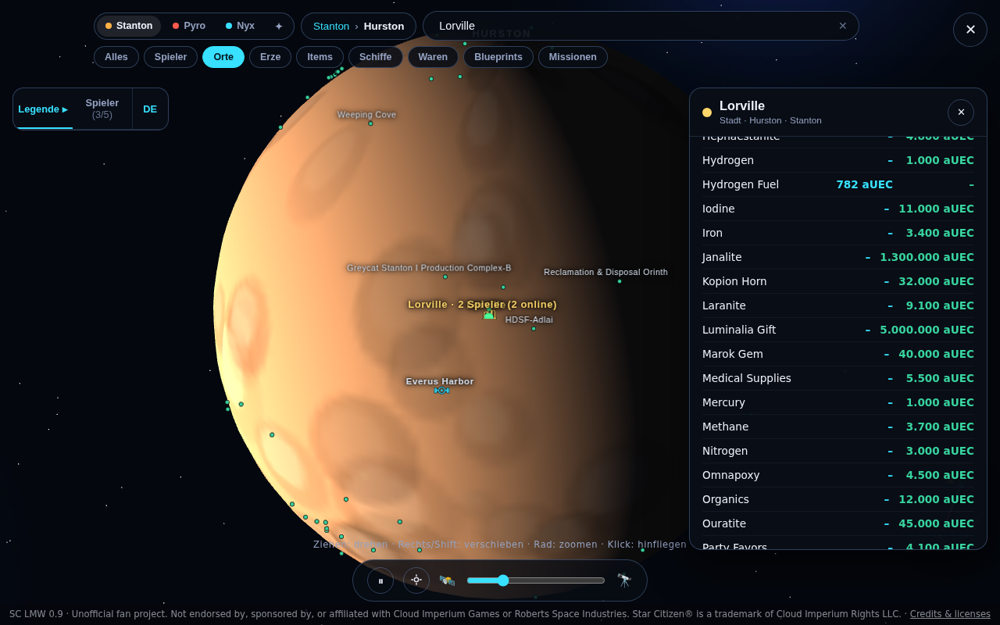
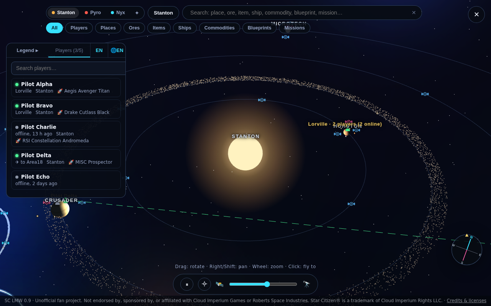

# SC LMW – Star Citizen LiveMap Wiki

**Version 1.0.0** · AGPL-3.0

**English** · [Deutsch](README.de.md) · [简体中文](#简体中文) · [繁體中文](#繁體中文)

**Website / 网站 / 網站：** https://gugugubear.pythonanywhere.com/

**Your whole 'verse on one screen.** A free, open-source 3D map of Star Citizen: every system, planet, moon, station and jump point, a search that knows where to find every ore, item, ship, commodity, blueprint and mission, live trade prices, holographic 3D ships, and your own org's pilots flying around on it in real time.

Drop it into your org website with one line of HTML, or hand the included prompt to an AI and let it do the wiring for you.

> **Unofficial fan project.** Not endorsed by, sponsored by, or affiliated with Cloud Imperium Games or Roberts Space Industries. Star Citizen® is a trademark of Cloud Imperium Rights LLC. The same notice is shown inside the app.

## What's new

The same note in four languages. A copy also lives in [docs/WHATS_NEW.md](docs/WHATS_NEW.md).

### English

- **The page speaks your language.** The first time you open it, it follows your browser. You can switch among Simplified Chinese, Traditional Chinese, English, and German from one button. That choice is remembered on this browser.
- **German shows German game labels. Chinese shows Chinese place names.** English keeps the English names.
- **The top of the map is one bar.** System, your place, search, categories, legend, and players sit on a single line. The language, theme, and close buttons are the same size.
- **Compact is the starting look.** You can still pick Classic, Practical, Chassis, or Sci-fi. Your pick is remembered.
- **Icons match the map.** Pause, home, and the other small pictures are simple line icons in the theme color.
- **A team room waits at the door.** Before the map, a short guide asks for a nickname. Use your in-game name so your captain recognizes you. There is no account.
- **The captain makes the room.** They get a short code, send it to the team, and accept each request. Only people in that room can see each other.
- **Say where you are.** Open a place on the map, then tap “I am here.” The page does not open your game folder. Or run the bundled Place Sync in `companion/` and let it try to read `Game.log`. The source is in the repository. Read [companion/README.md](companion/README.md) before you run it.
- **Draw a route together.** Turn on route marking, hold Shift, and click places in order. Add a note and publish it. Teammates can comment. The captain decides whether only they can draw, or the whole room can.
- **Menus use the theme colors.** Lists such as language, theme, and “who can draw” follow the look you picked.

### Deutsch

- **Die Seite spricht deine Sprache.** Beim ersten Öffnen folgt sie dem Browser. Über einen Knopf wechselst du zwischen vereinfachtem Chinesisch, traditionellem Chinesisch, Englisch und Deutsch. Die Wahl bleibt in diesem Browser gespeichert.
- **Deutsch zeigt deutsche Spielnamen. Chinesisch zeigt chinesische Ortsnamen.** Englisch bleibt bei den englischen Namen.
- **Oben ist eine Leiste.** System, Ort, Suche, Kategorien, Legende und Spieler stehen in einer Zeile. Sprache, Darstellung und Schließen sind gleich groß.
- **Kompakt ist der Start.** Klassisch, Praktisch, Gehäuse und Science-Fiction bleiben wählbar. Die Wahl bleibt gespeichert.
- **Die Symbole passen zur Karte.** Pause, Heimat und die anderen kleinen Bilder sind schlichte Strich-Icons in der Farbe des Themas.
- **Ein Teamraum steht vor der Karte.** Eine kurze Anleitung fragt nach einem Namen. Nimm deinen Namen aus dem Spiel, dann erkennt dich der Captain. Ein Konto gibt es nicht.
- **Der Captain legt den Raum an.** Er bekommt einen kurzen Code, gibt ihn weiter und nimmt jede Anfrage an. Nur dieser Raum sieht einander.
- **Sag, wo du bist.** Öffne einen Ort auf der Karte und tippe auf „Ich bin hier“. Die Seite öffnet keinen Spielordner. Oder starte die mitgelieferte Ortssynchronisation in `companion/` und lass sie `Game.log` lesen. Der Quelltext liegt im Repository. Lies [companion/README.md](companion/README.md), bevor du sie startest.
- **Zeichnet gemeinsam eine Route.** Schalte das Markieren ein, halte Shift und klicke die Orte der Reihe nach an. Schreib eine Notiz und veröffentliche sie. Das Team kann kommentieren. Der Captain legt fest, ob nur er zeichnet oder der ganze Raum.
- **Die Menüs tragen die Farben des Themas.** Sprache, Darstellung und „wer zeichnen darf“ sehen aus wie der Rest der Seite.

### 简体中文

- **页面会用你的语言。** 第一次打开时，跟着浏览器语言来。一个按钮里可以换简体中文、繁体中文、英文、德文。选过一次，这个浏览器会记住。
- **选德文时，游戏里的名称用德文。选中文时，地点名称用中文。** 选英文时，名称保持英文。
- **顶部合成一条。** 星系、你所在的位置、搜索、分类、图例和玩家排在同一行。语言、主题和关闭按钮一样大。
- **默认是紧凑外观。** 还可以换成经典、实用、机壳、科幻。选过的外观会被记住。
- **小图标和星图是同一套线条。** 暂停、回到恒星和其他小图，都用当前主题的颜色来画。
- **进图之前先看到团队房间。** 页面会请你填一个昵称。用游戏里的名字，队长更容易认出你。不需要注册账号。
- **队长建立房间。** 队长拿到一串房间码，发给队员，再逐个通过申请。只有这个房间里的人能互相看见。
- **告诉队友你在哪。** 在星图上点开一个地点，再点「我在这里」。这个网页不会打开你的游戏文件夹。也可以运行仓库里 `companion/` 附带的「地点同步」，让它试着读取 `Game.log`。源码就在仓库里，运行前先看 [companion/README.md](companion/README.md)。
- **一起画路线。** 打开路线标记，按住 Shift，按顺序点地点。写上备注再发布。队员可以留言。队长可以设定只有自己能画，或全房间都能画。
- **下拉菜单跟着主题走。** 语言、主题，以及「谁可以画路线」，颜色和形状都与当前外观一致。

### 繁體中文

- **頁面會用你的語言。** 第一次打開時，跟著瀏覽器語言來。一個按鈕裡可以換簡體中文、繁體中文、英文、德文。選過一次，這個瀏覽器會記住。
- **選德文時，遊戲裡的名稱用德文。選中文時，地點名稱用中文。** 選英文時，名稱保持英文。
- **頂部合成一條。** 星系、你所在的位置、搜尋、分類、圖例和玩家排在同一行。語言、主題和關閉按鈕一樣大。
- **預設是緊湊外觀。** 還可以換成經典、實用、機殼、科幻。選過的外觀會被記住。
- **小圖示和星圖是同一套線條。** 暫停、回到恆星和其他小圖，都用目前主題的顏色來畫。
- **進圖之前先看到團隊房間。** 頁面會請你填一個暱稱。用遊戲裡的名字，隊長比較容易認出你。不需要註冊帳號。
- **隊長建立房間。** 隊長拿到一串房間碼，發給隊員，再逐個通過申請。只有這個房間裡的人能互相看見。
- **告訴隊友你在哪。** 在星圖上點開一個地點，再點「我在這裡」。這個網頁不會打開你的遊戲資料夾。也可以執行倉庫裡 `companion/` 附帶的「地點同步」，讓它試著讀取 `Game.log`。源碼就在倉庫裡，執行前先看 [companion/README.md](companion/README.md)。
- **一起畫路線。** 打開路線標記，按住 Shift，依序點地點。寫上備註再發布。隊員可以留言。隊長可以設定只有自己能畫，或全房間都能畫。
- **下拉選單跟著主題走。** 語言、主題，以及「誰可以畫路線」，顏色和形狀都與目前外觀一致。

| Stanton, Pyro and Nyx in one view | Down to the planet |
|---|---|
|  |  |

| Search anything, see live prices | Your pilots, grouped by location |
|---|---|
|  |  |

*All screenshots use the fictional demo pilots from `players.example.json`.*

---

## What you can do with it

- **Run your org like a fleet command.** See who is online and where they are: Levski, Orison, a Pyro rest stop or halfway through a quantum jump. Five pilots at the same station collapse into one clean marker ("Levski · 5 pilots, 2 online"); tap it for the list.
- **Find anything in seconds.** Type "Quantanium", "Arrow", "Laranite", "P4-AR" or "Lorville" and the map flies you there. The search covers locations, ores, items, ships, commodities, blueprints and missions.
- **Plan trade runs.** Open any terminal and see live buy and sell prices from UEX, straight from the source, no API key needed.
- **Hunt blueprints.** Every blueprint in the game data with its full crafting recipe (parts, resources, minimum quality), and which missions reward it.
- **Scout missions.** See which mission types are offered where and by whom, and which blueprints they can reward.
- **Go mining.** Find which planets, moons and belts carry the ore you are after.
- **Run the big loops.** Contested Zones (Checkmate, Orbituary, Ruin Station), the supervisor stations and the Executive Hangar show the full procedure right at the location: a live Executive Hangar timer with the 5 status lights, a Ruin vault door timer you sync once per server, tap-to-start respawn timers, which keycards and boards you get or need, and the route maps. Align & Mine, Storm Breaker (Apex Valakkar), Siege of Orison and Jumptown are explained at their locations too, all linked to each other.
- **Find loot.** Item view shows which container and location types an item can drop from, ranked from best to rarer chance (optional, built from the Friendly Fire Department game-data export with `--with-loot`).
- **Works on the phone.** On small screens the controls sit in one dock at the bottom, all buttons are thumb-sized and nothing overlaps.
- **Show off the fleet.** Rotating holographic 3D models of the ships, loaded live from FleetYards, with specs, prices and where to buy or rent.
- **Put it on stream.** It runs in any browser source, so it works as an overlay or info screen for streams and org meetings.
- **Make it yours.** Plain HTML, CSS and JavaScript. No framework and no build step for the frontend, easy to restyle and extend.

## Install in 3 steps

You need Python 3 (to build the game data once) and any static web server.

```sh
# 1. Get the code
git clone https://github.com/nico-gordon-gilles/sc-lmw.git
cd sc-lmw

# 2. Build the game data (downloads the community game-data export and reference lists,
#    writes ./data/*.json; this takes a few minutes and needs internet access)
python3 scripts/build-all.py

# 3. Serve it and open http://localhost:8000/
python3 -m http.server 8000
```

That's it. You will see the map with five fictional demo pilots. Re-run step 2 after a game patch to refresh the data.

Optional: `python3 scripts/build-all.py --with-de` adds the German in-game texts (community translation, CC BY-NC-SA, see `scripts/README_DE_INI.md`).

## Put it on your website

**Option A: iframe (simplest, one line).** Upload the folder to your web host, then:

```html
<iframe src="https://your-site.example/sc-lmw/index.html"
        style="width:100%;height:640px;border:0" allow="fullscreen"></iframe>
```

**Option B: directly in your page.** A container and one script tag:

```html
<div id="sc-lmw" style="height:640px"></div>
<script src="https://your-site.example/sc-lmw/js/sc-lmw.js"
        data-base="https://your-site.example/sc-lmw/"
        data-players-url="https://your-site.example/api/players"></script>
```

The map stays inside its box. It never styles your `body`, fonts or layout, uses one global name (`window.SCLMW`), scales with its container and works from any domain or sub-folder. Both ways are tested against a deliberately "hostile" guest page: see [`examples/iframe.html`](examples/iframe.html) and [`examples/embed.html`](examples/embed.html).

## Interface language

The interface — buttons, panels, search, legend, error messages, time phrases, number format — is available in German, English, Simplified Chinese and Traditional Chinese. It follows the visitor's browser language (`zh-TW` / `zh-HK` / `zh-MO` → Traditional Chinese, other `zh*` → Simplified Chinese, `de*` → German, otherwise English). The language button opens the list and switches live, without a reload. The choice is remembered in that browser. You can also set it explicitly:

- `LANG` in `config.js`: `'auto'` (default), `'de'`, `'en'`, `'zh-Hans'`, or `'zh-Hant'`. `zh` / `zh-CN` / `zh-SG` count as Simplified, `zh-TW` / `zh-HK` / `zh-MO` as Traditional.
- `data-lang="zh-Hans"` on the `sc-lmw.js` script tag (direct-embed method).
- `mount(el, { lang: 'zh-Hans' })` if you call `SCLMW.mount()` yourself.

Choosing German also shows German mission and amenity names. Choosing Chinese shows Chinese place names. English keeps the English names. Details for visitors are in [docs/WHATS_NEW.md](docs/WHATS_NEW.md).

## Appearance

Five interface themes, switched from the ▣ button next to the language control and remembered in the browser: Classic (the original look), Compact, Practical, Chassis and Sci-fi.

- `THEME` in `config.js`: `'compact'` (default), `'classic'`, `'practical'`, `'chassis'`, or `'scifi'`.
- `data-theme="chassis"` on the script tag, or `mount(el, { theme: 'chassis' })`.
- A visitor's own choice wins over this default.

## Show your own pilots

Point `PLAYERS_URL` in `config.js` (or `data-players-url` on the script tag) at a small endpoint of yours that returns JSON like this:

```json
{
  "players": [
    { "id": "pilot-1", "name": "Pilot Alpha", "online": true,
      "last_seen": "2026-09-28T09:58:00Z",
      "code": "Nyx_Levski", "location": "Levski", "system": "Nyx",
      "ship": "Drake Cutlass Black" }
  ]
}
```

`code` is the location code Star Citizen writes into its `Game.log`. The map resolves it to the right station, city, outpost or rest stop by itself. Where that data comes from is up to you: a Discord bot, a companion app your members run, or a form on your site. The full contract, including travel destinations, the optional `when` field, refresh interval (`PLAYERS_POLL_MS`) and custom headers, is in [`docs/PLAYERS_API.md`](docs/PLAYERS_API.md).

## Let an AI build it into your site

[`docs/AI_INTEGRATION.md`](docs/AI_INTEGRATION.md) contains a complete, copy-paste prompt (English and German) for Claude, ChatGPT or any coding assistant. It explains your setup to the AI: copying the files, building the data, choosing iframe or direct embed, creating a players endpoint (with ready examples for Node/Express, Python/Flask and PHP), CORS, keeping the fan-project notice visible, and your AGPL obligations. Paste it, add one line about your own site, and the AI can do the rest without asking back.

Short version to get started:

```text
I want to add SC LMW (https://github.com/nico-gordon-gilles/sc-lmw), an open-source
Star Citizen 3D map, to my website. Read its README.md, docs/AI_INTEGRATION.md and
docs/PLAYERS_API.md, then: build the data with scripts/build-all.py, embed the map
(iframe or the sc-lmw.js script tag), and create a players endpoint in my backend that
returns the JSON format from PLAYERS_API.md. Keep the "unofficial fan project" notice
visible. My site is: <describe your stack and where the map should appear>.
```

## Where the data comes from

| What | Source | How |
|---|---|---|
| Locations, ores, items, blueprints, missions | community `scunpacked-data` export of the game files | built locally by `scripts/`, **not shipped** in this repo |
| Trade prices | [UEX Corp](https://uexcorp.space) API | fetched live in the browser |
| Ship specs and 3D models | [FleetYards](https://fleetyards.net) | fetched live in the browser, credited in the app |
| 3D engine | [three.js](https://threejs.org) r128 (MIT) | included under `vendor/three/` |
| Your pilots | your own `PLAYERS_URL` | optional |

Game data and images are not redistributed here. Every user builds them from the original sources. RSI star-map images are intentionally not downloaded. Full attribution: [`CREDITS.md`](CREDITS.md).

**Guides and optional extras**

- Gameplay procedures and route maps: [starcitizen.tools](https://starcitizen.tools) (maps and photos CC BY-SA 4.0, see `img/guides/` and CREDITS.md).
- Executive Hangar cycle: [exec.xyxyll.com](https://exec.xyxyll.com) (MIT). `scripts/exec-build.py` refreshes it into `data/exec.json` (run by `build-all.py`; without it the map uses built-in values).
- Respawn times: [exectimer.com](https://exectimer.com).
- Loot locations: [Friendly Fire Department](https://thefriendlyfiredepartment.org) game-data export, only with `python3 scripts/build-all.py --with-loot`. Not redistributed in this repository.

## Project layout

```
index.html              standalone page
config.js               the one file most people edit (PLAYERS_URL, ...)
players.example.json    five fictional demo pilots
js/starmap.js           map engine: 3D scene, search, categories, prices, blueprints, missions
js/holo.js              FleetYards 3D ship models
js/i18n.js              interface language (de / en / zh-Hans / zh-Hant)
js/sc-lmw.js            one-script-tag loader for embedding
css/starmap.css         styles under .sc-lmw; themes classic, compact, practical, chassis, scifi
vendor/three/           three.js r128 + loaders (MIT)
scripts/                data build pipeline (Python)
examples/               iframe and direct-embed examples
docs/                   players API, AI integration prompt, screenshots
companion/              optional local Place Sync. Source you can read. See companion/README.md
server/                 optional room service. The page does not read the game folder
```

## Show us what you build

Fork it, restyle it, add features, run it for your org. If you build something with it, we would love to see it: open an issue on this repository and tell us. No obligation, just curiosity.

## License

**AGPL-3.0** (see [`LICENSE`](LICENSE)). You may use, change and share it freely. If you run a **modified** version on a server that other people use, you must make your modified source code available to them as well. Third-party code and data keep their own licenses, see [`CREDITS.md`](CREDITS.md).
